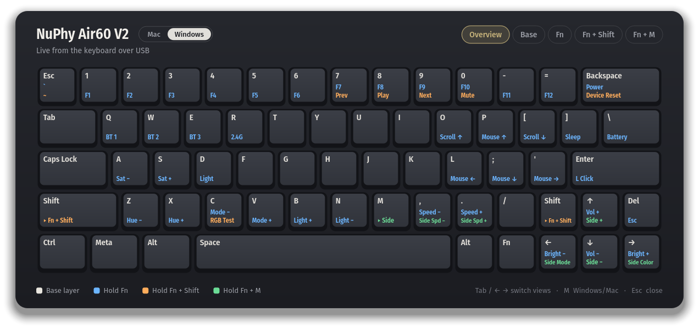
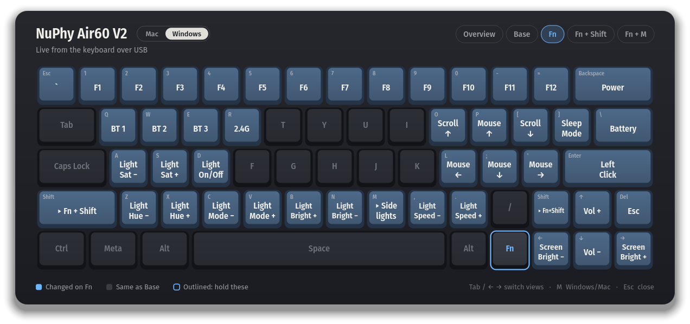
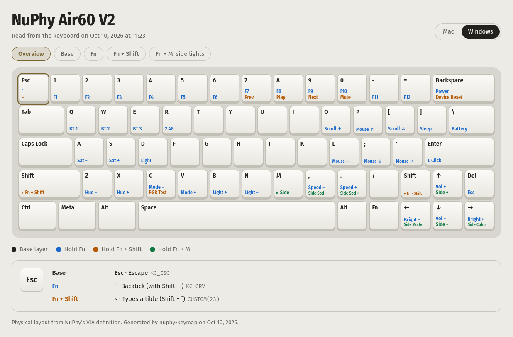

# NuPhy Air60 V2 on Linux

[](https://github.com/Supramik/nuphy-air60-linux/actions/workflows/tests.yml)

Two tools for using a [NuPhy Air60 V2](https://nuphy.com/products/air60-v2) with a Linux laptop:

- **nuphy-keymap** shows your keymap on a hotkey: every layer, drawn on the real keyboard layout. It reads the layers from the keyboard itself, so it is never out of date, and keeps backups of your keymap and macros that it can write back after a reset.
- **toggle-internal-keyboard** switches the laptop's built-in keyboard off and on, so the NuPhy can sit on top of it.

Made on CachyOS with KDE Plasma 6 on Wayland. Not affiliated with NuPhy.



## nuphy-keymap

Press <kbd>Meta</kbd>+<kbd>Shift</kbd>+<kbd>K</kbd> and the keymap appears over a dimmed screen.

- **Overview** prints every layer on the keycaps, like side-printed legends: white for the base layer, blue for Fn, orange for Fn + Shift, green for Fn + M.
- **A tab per layer** highlights the keys that layer changes and outlines the keys you hold to get there.
- **Windows / Mac** matches the switch on the side of the keyboard.
- Hover a key to see everything it does, with its VIA keycode.



### Always current

Nothing about your keymap is hard-coded. Each time it opens, nuphy-keymap uses the freshest source it has:

1. **USB cable:** it reads every layer and macro from the keyboard with the VIA protocol. Only `restore` (see [Backups](#backups)) ever writes to it, and nothing touches the keyboard while VIA has it open.
2. **Bluetooth or the 2.4G dongle:** the keyboard can't be read wirelessly, so it shows the last keymap it read over USB and says how old that is.
3. **Before the first USB read:** a VIA export (Save + Load > Save Current Layout) saved in `~/.config/nuphy-air60/via/`.

The physical layout comes from NuPhy's VIA definition file. Layer names such as Fn + Shift and the Windows/Mac split are worked out from the keymap itself, so they follow your changes in VIA.

Under the hood, the keyboard's VIA interface (raw HID, usage page `0xFF60`) answers a handful of read commands: protocol version, layer count, the keymap buffer 28 bytes at a time, and the same for the macros. nuphy-keymap decodes the 16-bit keycodes for VIA protocols 10 through 12 into the names VIA itself uses, then finds the Fn layers by following the layer keys (`MO`, `TT`, `OSL` and so on) outward from each base layer. `restore` writes with the same commands VIA sends when you change a key or a macro.

### Install

You need Python 3.10 or newer and PyQt6 (`python-pyqt6` on Arch, `python3-pyqt6` on Debian, Ubuntu and Fedora). The default shortcuts are for KDE Plasma; on other desktops, bind a key to `bin/nuphy-keymap` yourself. The overlay looks best with Fira Sans installed.

```sh
git clone https://github.com/Supramik/nuphy-air60-linux.git ~/Projects/nuphy-air60-linux
cd ~/Projects/nuphy-air60-linux
./install.sh viewer
```

The shortcut runs the script from the folder you cloned, so leave it there. If you do move it, run `./install.sh viewer` again from the new place (and `./install.sh usb-hook`, if you use it); otherwise the shortcut says it can't find the program.

Then download NuPhy's VIA file for the Air60 V2 from [JSON files for NuPhy keyboards](https://nuphy.com/pages/json-files-for-nuphy-keyboards), the same file you load into VIA's Design tab, and save it as `~/.config/nuphy-air60/via/definition.json`. Plug the keyboard in by USB once so nuphy-keymap can read your layers.

`./install.sh viewer` adds a launcher with the shortcuts. If you don't have one yet, it also installs a udev rule that lets your user open the keyboard over USB; VIA in the browser needs the same rule. And it adds `nuphy`, a short command for the terminal, to `~/.local/bin`. If that folder isn't on your PATH yet, the installer shows the line to add to your shell's startup file.

### Use

| Key | What it does |
|---|---|
| <kbd>Meta</kbd>+<kbd>Shift</kbd>+<kbd>K</kbd> | Show or hide the keymap, from any keyboard |
| <kbd>F19</kbd> | The same, but only the NuPhy can send it. In VIA, set a key on both Fn layers (1 and 4) to `KC_F19` under Special > Any, and Fn + that key opens the keymap whenever the NuPhy is connected. |
| <kbd>Tab</kbd>, <kbd>←</kbd> <kbd>→</kbd>, <kbd>1</kbd>–<kbd>5</kbd> | Switch views |
| <kbd>M</kbd> | Switch between Windows and Mac |
| <kbd>Esc</kbd> or a click outside | Close |

From a terminal (without the installer, `bin/nuphy-keymap` in the folder you cloned does the same as `nuphy`):

```sh
nuphy html     # the same view as an interactive web page
nuphy text     # every layer as text
nuphy sync     # read the keyboard and save a snapshot
nuphy verify   # compare the keyboard with your newest VIA export
nuphy backups  # list the saved keymaps (see Backups below)
nuphy restore  # write one back to the keyboard
```



### Refresh over USB by itself (optional)

```sh
./install.sh usb-hook
```

While the keyboard is plugged in by USB, a small service re-reads the keymap about 5 seconds after VIA closes and every 5 minutes, and sends a notification when it saves a change. It starts when you plug in and stops when you unplug. This is what makes the [backups](#backups) automatic: whatever you change in VIA is saved as soon as you close it.

### Backups

Whenever nuphy-keymap reads the keyboard over USB and finds the keymap or macros changed, it saves the new version next to the old ones: every layer and every macro, in VIA's own layout format. With the USB hook above, that happens a few seconds after you close VIA, so you no longer need to save a layout from VIA after each change. The newest 25 are kept in `~/.config/nuphy-air60/snapshots/`.

```sh
nuphy backups      # newest first, with how many keys changed from one to the next
nuphy restore      # write back the newest one that differs from the keyboard
nuphy restore 3    # or number 3 from the list, or any VIA layout file
```

After an accidental reset, plug in by USB and run `nuphy restore`. The reset keymap gets saved as well, but `restore` skips it, since the keyboard already has it, and puts back the keymap you had before.

`restore` needs the USB cable, with VIA closed. Before it writes anything, it saves what the keyboard has now (so a restore can be undone the same way), lists every key it will change, and asks. Then it changes only those keys, rewrites the macros if they differ, and reads everything back to check. It writes keyboards with VIA protocol 11 or 12, which includes the Air60 V2.

Every backup also loads in VIA: Save + Load > Load Saved Layout. The folder is hidden, so type or paste the path in the file dialog. Backups hold what VIA's layout files hold, the keymap and macros; lighting isn't in them.

### Other VIA keyboards

Only NuPhy's friendly key names and the udev rules (USB vendor `19f5`) are specific to NuPhy; everything else comes from the VIA definition. Other VIA keyboards may work with their own definition in `$NUPHY_KEYMAP_HOME/via/` and udev rules for their vendor ID, but only the Air60 V2 is tested.

## toggle-internal-keyboard

Turns the laptop's built-in keyboard off and on at the kernel level, so it behaves the same on Wayland and X11 and leaves USB and Bluetooth keyboards alone.

```sh
./install.sh toggle
```

This copies the script to `/usr/local/bin`, lets you run it without a password so a shortcut can call it, binds it to <kbd>Meta</kbd>+<kbd>K</kbd>, and switches the laptop keyboard back on after every suspend, so you're never left without one.

```sh
sudo toggle-internal-keyboard          # switch
sudo toggle-internal-keyboard off      # or on
toggle-internal-keyboard status        # no root needed
```

It expects the built-in keyboard on the PS/2 port at `/sys/devices/platform/i8042/serio0`, where most laptops have it. A plain driver unbind doesn't stick on that port, because the kernel re-attaches the driver straight away, so the script switches the port to manual binding while the keyboard is off.

## Uninstall

Add `--remove` to any step, for example `./install.sh usb-hook --remove`.

## Tests

```sh
python3 -m unittest discover -s tests
```

## License

[MIT](LICENSE). NuPhy's VIA definition isn't included; download it from NuPhy.
